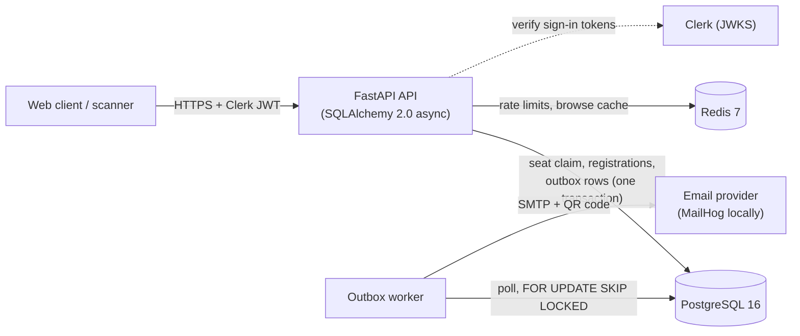

# EntriX

A backend for college sports events (think ITUSA or an intra-college fest) where hundreds of
students try to register in the same few minutes, seats per sport are limited, and check-in on
the day is chaotic.

What it guarantees, and how each is tested:

| Guarantee | How |
|---|---|
| A category is never overbooked, even under hundreds of simultaneous requests | one atomic conditional `UPDATE`; 200 users race for 50 seats in the test suite |
| A retried or double-clicked request never creates two registrations | `Idempotency-Key` row inserted in the same transaction as the work |
| A fair waitlist that promotes automatically on cancellation | promotion under the category row lock; FIFO order is tested |
| No confirmed seat without a queued email, and no email for a rolled-back seat | transactional outbox, polled by a worker with retries |
| QR check-in that cannot be forged and is safe to scan twice | HMAC-signed tokens, constant-time check, idempotent check-in |
| Teams (cricket, indoor sports) with locked rosters | team = one seat, same seat logic as individuals |
| Honest performance numbers | only from the recorded load test, see [LOADTEST.md](LOADTEST.md) |

## Architecture



**One registration, step by step**

1. The request carries an `Idempotency-Key`. The API checks the rate limit (Redis), then opens a transaction.
2. It inserts the idempotency row. A duplicate waits on that row's unique index, then replays the stored answer.
3. `UPDATE categories SET confirmed_count = confirmed_count + 1 WHERE id = ? AND confirmed_count < capacity`: the database decides who gets the last seat.
4. Seat won: insert the registration as `confirmed`. Category full: lock the category, retry once, then insert it as `waitlisted`.
5. In the same transaction, queue an `outbox` row. Commit. Nothing is ever emailed inside the request.
6. The worker picks up the outbox row, builds the email with an inline QR, and sends it; failures retry with backoff.

Design reasoning and the bugs found along the way are in [DESIGN.md](DESIGN.md); the milestone-by-milestone log in [decisions.md](decisions.md).

## Run it locally

You need Python 3.12+ and Docker.

```bash
python -m venv .venv
.venv\Scripts\activate            # macOS/Linux: source .venv/bin/activate
pip install -e ".[dev]"

docker compose up -d postgres redis mailhog
alembic upgrade head
uvicorn app.main:app --reload     # API on http://localhost:8000 (docs at /docs)
python -m app.worker.outbox_worker   # in a second terminal: sends the emails
```

MailHog's inbox, where the confirmation emails (with QR codes) land, is http://localhost:8025.

Postgres is published on host port **5433**, not 5432, in case a native Postgres owns 5432.

In local development, sign in by sending a header: `X-Dev-User: you@example.com`, and on the
first request `X-Dev-Role: organizer` (or `volunteer`, `admin`) to pick a role. This only works
with `AUTH_MODE=dev`; the app refuses to start with it when `ENV=prod`.

### Everything in containers

```bash
docker compose up -d --build     # postgres, redis, mailhog, migrate, api (:8000), worker
```

### Tests and lint

```bash
ruff check .
pytest -q
```

The tests run against **real PostgreSQL** (a throwaway `sportreg_test` database built by the
real Alembic migration), never SQLite, because concurrency is the whole point. The Redis tests
use a real Redis too; they skip if it is not running (`docker compose up -d redis`).

### Load test

```bash
pip install -e ".[loadtest]"
python -m loadtests.run_loadtest --label cache-off --cache off
python -m loadtests.run_loadtest --label cache-on  --cache on
python -m loadtests.summarize     # rebuilds LOADTEST.md from the raw results
```

## Layout

```
app/
  main.py config.py db.py deps.py errors.py models.py schemas.py auth_clerk.py
  routers/    events categories registrations teams checkin organizer me health
  services/   registration_service team_service checkin_service idempotency
              qr outbox rate_limit cache redis_client
  worker/     outbox_worker emails
alembic/      migrations (no create_all in app code)
tests/        real-Postgres tests, one file per feature
loadtests/    Locust scenarios, runner, invariant check, results/
render.yaml   free Render Blueprint   render.paid.yaml  full architecture
scripts/      send_test_email (email deliverability check)   DEPLOY.md  deployment guide
```

## Deploying

[DEPLOY.md](DEPLOY.md) covers a **free** setup (one Render web service running the API, the
email worker and migrations; Neon for Postgres; Brevo for email; Clerk for sign-in) and points
to `render.paid.yaml` for the full architecture (separate worker, Redis, managed Postgres).
Before relying on email, send yourself a real test:
`python -m scripts.send_test_email you@gmail.com`.

## Documents

- [SPEC.md](SPEC.md): the specification this was built from.
- [DESIGN.md](DESIGN.md): why it works the way it does, plus the bug log.
- [decisions.md](decisions.md): plain-language decision log per milestone.
- [LOADTEST.md](LOADTEST.md): measured results and their limits.
- [DEPLOY.md](DEPLOY.md): putting it online.
